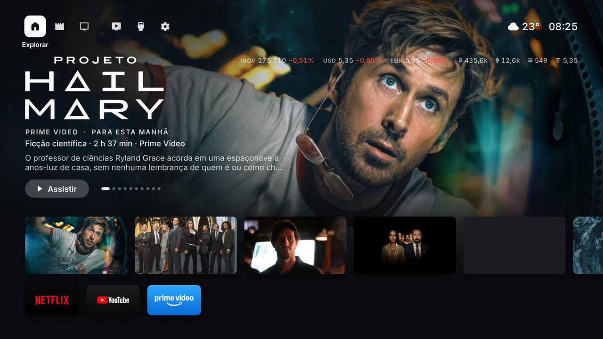
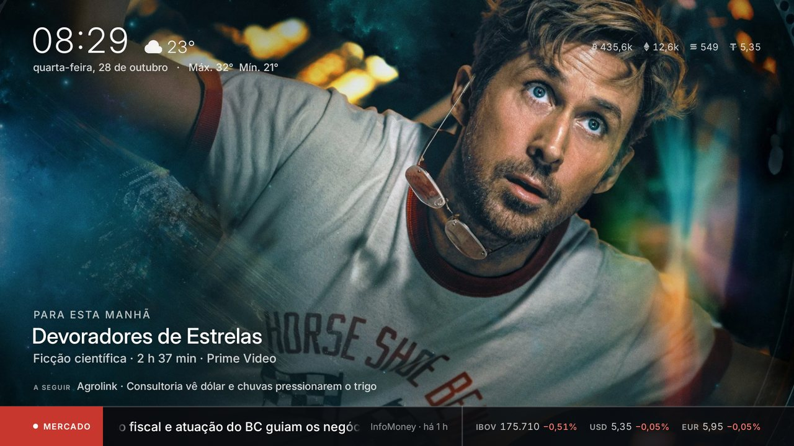

# Sony XBR-75X905E: debloat por ADB e uma tela inicial mais leve

Deixe a **Sony Bravia XBR-75X905E** (Android TV 9, 2 GB de RAM) mais leve em duas etapas, sem root:

1. **Debloat por ADB.** O script remove do seu usuário a vitrine, a ajuda, a demonstração de loja e o modo hotel da Sony, mais a telemetria do Google. Opcionalmente, remove também o Discover, o navegador, o espelhamento e a busca por voz. Dá para desfazer com um comando.
2. **Trocar a tela inicial pelo [Free My TV](https://github.com/simbasjungles/free-my-tv).** É um launcher de código aberto que suporta Sony, com as entradas HDMI, os botões do controle e sem anúncios patrocinados.

<p align="center">
  
  
</p>

Estas capturas mostram uma versão personalizada do Free My TV, com visual estilo Fire TV e widgets de mercado. O Free My TV original tem outro visual.

Testado na XBR-75X905E (`BRAVIA_ATV2`), Android TV 9, build `PTT1.190515.001.S54`, firmware brasileiro:

| | Antes | Depois |
|---|---|---|
| RAM livre com a TV parada | ~400 MB | **~775 MB** |
| Memória da tela inicial | 167 MB (Google) | 57–64 MB (Free My TV) |
| Anúncios na tela inicial | sim ("Patrocinado") | não |

---

## 1. Conectar a TV por ADB

Esta TV não tem *Depuração por Wi-Fi* com código. Ligar a depuração USB já libera o ADB pela rede na porta 5555. Você precisa do [Android SDK Platform-Tools](https://developer.android.com/tools/releases/platform-tools) (`adb`) no computador, na mesma rede da TV.

1. **Configurações → Sobre →** clique 7 vezes em **Versão** (ou *Build*) para liberar as Opções do desenvolvedor.
2. **Configurações → Opções do desenvolvedor →** ative **Depuração USB**.
3. Anote o IP da TV em **Configurações → Rede → Status da rede**.
4. No computador:

```sh
adb connect 192.168.0.X:5555
```

A TV pergunta **"Permitir depuração USB?"**. Marque **"Sempre permitir deste computador"** e confirme.

## 2. Debloat

```sh
cd debloat
./debloat.sh                          # mostra o que sairia, sem remover nada
./debloat.sh --aplicar                # remove a lista padrão
./debloat.sh --aplicar --opcionais    # remove também os opcionais
```

- **Sem root:** usa `pm uninstall -k --user 0`. O app sai do seu usuário e o APK continua na partição do sistema. Uma restauração de fábrica traz tudo de volta.
- **Backup:** antes de remover, salva a lista completa de pacotes (`antes-*.txt`) e o que foi removido (`removidos-*.txt`).
- **Desfazer:** `./restaurar.sh removidos-AAAAMMDD-HHMMSS.txt`. Sem argumento, restaura todos das duas listas.
- **Mais de um aparelho conectado:** use `ADB_DEVICE=ip:5555 ./debloat.sh ...`.

### O que sai

A lista completa, comentada linha por linha, está em [`debloat/pacotes.txt`](debloat/pacotes.txt). A base foi a classificação do [Universal Android Debloater Next Generation](https://github.com/Universal-Debloater-Alliance/universal-android-debloater-next-generation). O UAD não conhece 92 dos 166 pacotes desta TV, quase todos da Sony. Desses, só entraram os de vitrine, demonstração e modo hotel.

| Grupo | Pacotes |
|---|---|
| Vitrine, ajuda e demonstração da Sony | Sony Select, Ajuda inteligente, i-Manual, modo demo de loja (3 pacotes) |
| Modo hotel e profissional (B2B) | prosettings, RS-232C, vendorprotocol, importexport |
| Google | Play Games, envio de bug report, Feedback, assistentes de primeira configuração |

**Opcionais**, em [`debloat/pacotes-opcionais.txt`](debloat/pacotes-opcionais.txt). Apague do arquivo as linhas do que você usa:
- **Sony Discover:** a barra de conteúdo do botão Discover, ~27 MB.
- **Navegador Vewd:** alguns apps abrem links nele; o [TV Bro](https://github.com/truefedex/tv-bro) substitui.
- **Espelhamento de tela (Miracast):** o Chromecast embutido continua funcionando.
- **Player de música e relógio/timers da Sony:** o timer de desligar sai junto.
- **Busca por voz do Google (`katniss`, ~41 MB):** sem ela, o microfone do controle para de funcionar.

### Não remova

- **`com.sony.dtv.b2b.hotelmode`:** parece só mais um pacote do modo hotel, mas o serviço `com.sony.dtv.tvdotactiondevicecontrol` usa um componente dele (`com.sony.dtv.b2b.hotelsettings`) e fecha em loop sem ele. Se você já removeu, rode `adb shell cmd package install-existing --user 0 com.sony.dtv.b2b.hotelmode`.
- **Pacotes de imagem, som, entradas HDMI e antena, HDMI-CEC (Bravia Sync), controle remoto, rede e atualização do sistema:** `com.sony.dtv.tvx`, `tvinput.*`, `panelsettings`, `braviasync*`, `systemupdate`, entre outros.
- **Play Store, Play Services, WebView e Chromecast embutido.**
- **Apps de streaming** (YouTube, Netflix, Prime Video): não estão em nenhuma lista. Desinstale pela própria TV se quiser.

Depois de remover qualquer coisa, confira se algum serviço passou a fechar:

```sh
adb logcat -d -b crash | grep "Process:"
adb logcat -d | grep "Failed to find provider info"
```

[`debloat/pacotes-sistema-x905e.txt`](debloat/pacotes-sistema-x905e.txt) traz os 166 pacotes de sistema de fábrica, para consulta.

> Use por sua conta e risco. Mesmo reversível, remover um pacote pode afetar alguma função que você usa. Rode antes sem `--aplicar` e leia a lista.

---

## 3. Tela inicial mais leve

A tela inicial da Google é o processo que mais pesa nesta TV: 145–167 MB. Ela também exibe anúncios patrocinados. O [Free My TV](https://github.com/simbasjungles/free-my-tv) a substitui com:
- as entradas HDMI e a antena;
- os botões do controle da Sony (Netflix, Prime Video, YouTube), que podem abrir o app que você escolher;
- um modo **Original**, que traz a tela da Google de volta.

Siga a [instalação do projeto](https://github.com/simbasjungles/free-my-tv#install). Na TV, faça a troca em **Free My TV → Tela inicial → Free My TV**.

Duas observações para esta TV, que é mais fraca:
- **Tela de descanso a 60 Hz:** se ela animar a 60 quadros por segundo, a TV entrega uns 25 e o texto anda aos trancos. Limitar a 30 quadros deixa estável: cada quadro fica pronto em 18–20 ms.
- **Efeitos de vidro:** o Android 9 não tem os efeitos de vidro (AGSL) das versões novas, e o app usa a versão simples automaticamente.

---

## Licença

[MIT](LICENSE)
